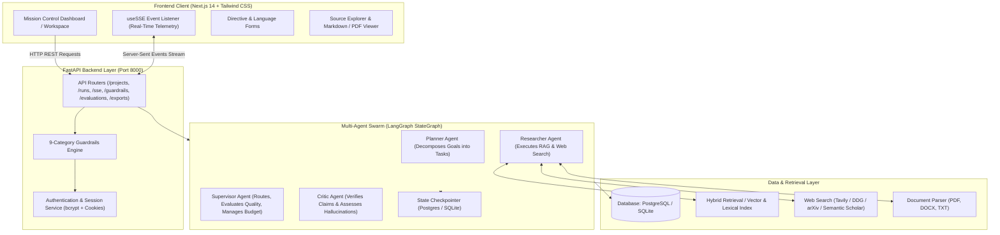
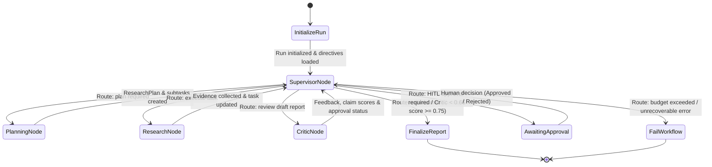
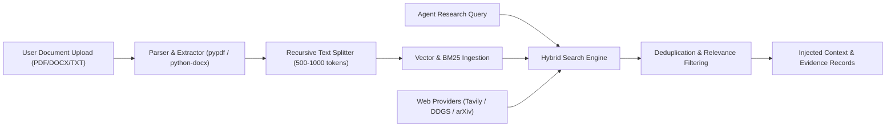
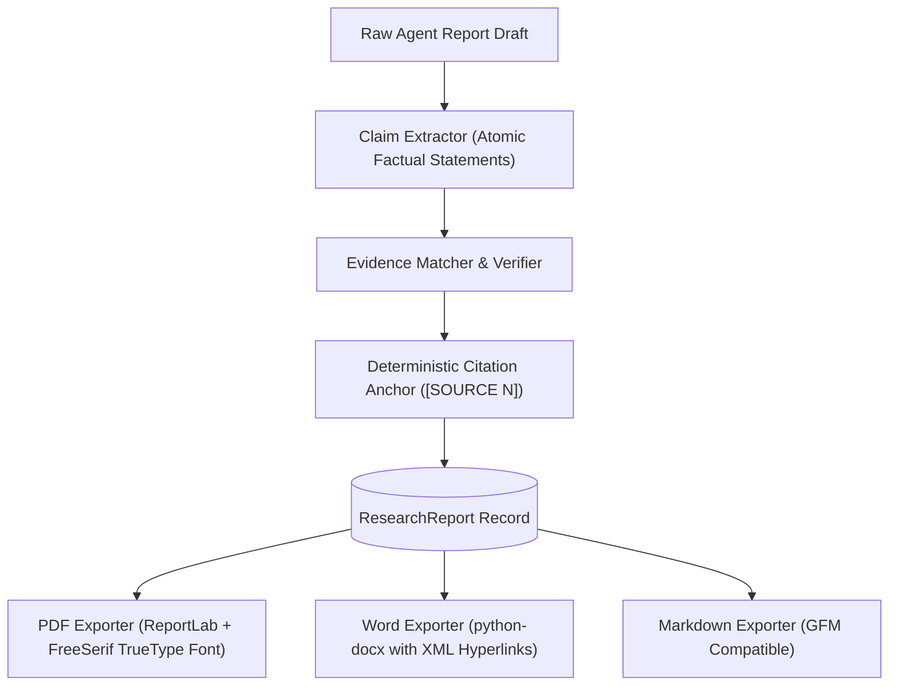
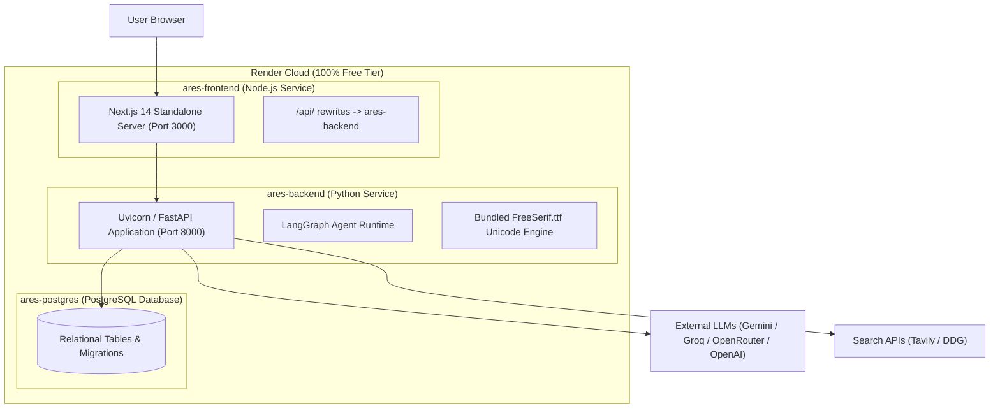

# ARES (Autonomous Research & Evidence System)
## Complete System Architecture & Technical Specification

---

## 1. Executive Architecture Overview

**ARES** is a production-grade, multi-agent research automation platform. It coordinates specialized autonomous AI agents via **LangGraph**, executes real-time document and web information retrieval, validates factual claims against extracted evidence, enforces a 9-layer safety guardrail pipeline, and streams live telemetry to a Next.js 14 mission control dashboard.

---

## 2. Multi-Agent Swarm & LangGraph State Machine

The multi-agent swarm operates on an asynchronous state graph (`StateGraph`) managed by **LangGraph**. Agents communicate deterministically via a shared state object (`ResearchWorkflowState`) persisted across cycles.

### Agent Roles & Specifications

| Agent | Module | Primary Responsibilities |
|---|---|---|
| **Planner** | `backend/app/agents/planner.py` | Decomposes the research question into granular subtasks with explicit dependencies, priorities, and assigned retrieval modes (Document vs. Web Search). Honors user directives and target output languages. |
| **Supervisor** | `backend/app/agents/supervisor.py` | The central orchestrator. Evaluates the completion of each subtask, monitors token and loop budgets, routes between agents, and synthesizes intermediate findings into a cohesive report draft. |
| **Researcher** | `backend/app/agents/researcher.py` | Executes retrieval operations. Queries local document chunks and external search engines, filters noise, extracts factual evidence snippets, and formats sources. |
| **Critic** | `backend/app/agents/critic.py` | Evaluates synthesized reports against source evidence. Checks for hallucinations, computes citation groundness scores, flags contradictions, and triggers human approval escalations if confidence is below threshold (< 0.65). |

---

## 3. Data & Retrieval Pipeline (Hybrid RAG)

1. **Document Processing (`app/services/document_service.py`)**:
   - Binary inspection validating magic bytes (`%PDF-`, `\x89PNG`, `PK...`).
   - Text extraction with page-level mapping for citations.
   - Chunking with configurable chunk size and overlap.
2. **Search Provider Aggregator (`app/services/search_service.py`)**:
   - Supports **Tavily**, **DuckDuckGo**, **arXiv**, and **Semantic Scholar**.
   - Automatic fallback across providers with strict SSRF protection (`is_safe_url`).

---

## 4. Verification, Citations & Multi-Lingual Export Pipeline

- **TrueType Unicode Engine**: Uses bundled `FreeSerif.ttf` with ReportLab `pdfmetrics` to guarantee cross-platform support for Latin, Devanagari (Hindi), Cyrillic, Greek, and Arabic scripts without tofu squares.
- **Dynamic On-the-Fly Re-generation**: On ephemeral cloud hosts (e.g., Render), any expired or missing report is automatically regenerated on demand from database records.

---

## 5. Security & 9-Layer Guardrails Framework

Every input, agent action, tool call, and generated output passes through the ARES Guardrails Engine (`backend/app/guardrails/`):

| Layer | Implementation Module | Guardrail Responsibilities |
|---|---|---|
| **1. Input Guardrails** | `input_guardrails.py` | Prompt injection detection, jailbreak heuristics, SQL/shell payload defense, automatic PII masking. |
| **2. Output Guardrails** | `output_guardrails.py` | Hallucination mitigation, automated API key and credential redaction, schema compliance. |
| **3. Tool Guardrails** | `tool_guardrails.py` | Role-Based Access Control (RBAC) per agent, strict private IP/SSRF blocking. |
| **4. Data Guardrails** | `data_guardrails.py` | Project-boundary isolation, preventing cross-tenant data leakage. |
| **5. Security Guardrails** | `security_guardrails.py` | Cross-agent state poisoning protection, trace sanitization. |
| **6. Operational Guardrails** | `operational_guardrails.py` | Hard loop caps (max 30 supervisor cycles, max 3 critic cycles), token budget limits (50k tokens), timeout enforcement. |
| **7. Human-in-the-Loop** | `hitl_guardrails.py` | Critical action gating, low-confidence escalation, supervisor handoff triggers. |
| **8. Multi-Agent Guardrails** | `multi_agent_guardrails.py` | Circular ping-pong loop detection, message schema validation, agent-to-agent conflict resolution. |
| **9. Ethical & Compliance** | `ethical_guardrails.py` | Demographic bias detection, mandatory limitations disclosure, compliance logging. |

---

## 6. Frontend Architecture (Next.js 14 App Router)

- **Framework**: Next.js 14 with TypeScript, Tailwind CSS, and Radix UI / shadcn/ui components.
- **Real-Time Telemetry**: Custom `useSSE` hook subscribing to `/api/v1/projects/{id}/runs/{id}/stream` for streaming live agent activity, plan evolution, and task progress without manual page refreshes.
- **Route Hierarchy**:
  - `/` — Mission Control Dashboard (Recent projects, system stats, quick launch).
  - `/login` — Starter page with ambient background video reveal and guest initialization.
  - `/projects/[id]` — Interactive research workspace (Document upload, research parameters, live swarm feed, report viewer, and citation inspector).
  - `/evaluations` — 6-dimension evaluation dashboard with benchmark test suites.
  - `/tokens` — Token consumption leaderboards, cost calculations, and agent burn rate charts.

---

## 7. Database & Persistence Layer

The database layer utilizes **SQLAlchemy 2.0 (async)** with **Alembic** migrations:
- **Production Database**: PostgreSQL (configured via `DATABASE_URL`).
- **Local Database**: SQLite with WAL mode (`PRAGMA journal_mode=WAL`).
- **Core Entities**:
  - `User`, `Session`, `LoginAttempt` (Security & Auth)
  - `ResearchProject`, `UploadedDocument`, `DocumentChunk` (Workspace & Ingestion)
  - `ResearchRun`, `ResearchPlan`, `ResearchTask`, `AgentExecutionEvent` (Workflow & Telemetry)
  - `Source`, `EvidenceRecord`, `Claim`, `ClaimVerification`, `CriticReview`, `Citation` (Evidence & Fact Checking)
  - `ResearchReport`, `ReportVersion`, `ExportRecord` (Synthesis & Downloads)
  - `ApprovalRequest` (Human-in-the-Loop Decisions)

---

## 8. Deployment Topology

---

## 9. Key Architecture References in Codebase

| Component | Primary Files |
|---|---|
| **LangGraph Orchestrator** | `backend/app/graph/workflow.py`, `backend/app/graph/executor.py` |
| **Agent Implementations** | `backend/app/agents/planner.py`, `backend/app/agents/researcher.py`, `backend/app/agents/supervisor.py`, `backend/app/agents/critic.py` |
| **Guardrails Framework** | `backend/app/guardrails/*.py`, `backend/app/api/v1/routes/guardrails.py` |
| **Evaluation Suite** | `backend/app/evaluation/*.py`, `backend/app/api/v1/routes/evaluations.py` |
| **Export & Typography Engine** | `backend/app/services/export_service.py`, `backend/app/assets/fonts/FreeSerif.ttf` |
| **Frontend Workspace & SSE** | `frontend/src/components/workspace/*`, `frontend/src/lib/hooks/useSSE.ts` |
| **Database Models** | `backend/app/models/*.py`, `backend/alembic/versions/*.py` |
| **Phase Milestone Plans** | `maar-phase1-plan.md` through `maar-phase6-plan.md` |
| **Historical Design Specs** | `docs/02_TECHNICAL_ARCHITECTURE.md`, `docs/21_MULTI_AGENT_TECHNICAL_ARCHITECTURE.md`, `docs/41_PHASE_5_TECHNICAL_ARCHITECTURE.md` |
